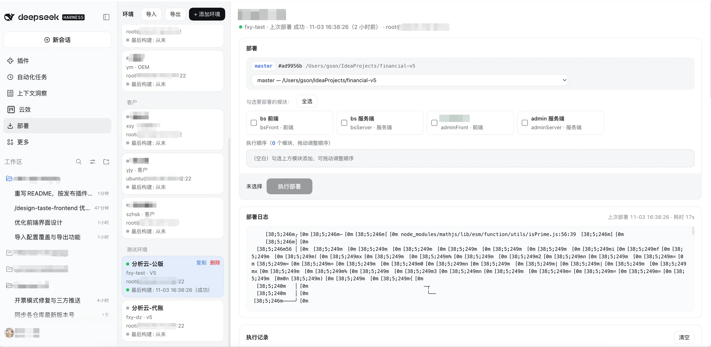

# dsh-app-deploy

[](https://www.npmjs.com/package/dsh-app-deploy)

[DeepSeek Harness](https://www.npmjs.com/package/@deepseek-ai/dsh)（DSH）插件：把交互式部署工具收进 DSH Web 面板。按环境分组管理配置，勾选模块、拖拽编排执行顺序，一键完成 Gradle 构建、rsync 同步与 SSH 远程命令，实时推送日志并保留执行记录。



## 特性

- **部署面板**：侧边栏「部署」入口，按环境分组管理，模块勾选 + 拖拽排序，一键部署。
- **实时日志**：SSE 推送 gradle / rsync / ssh 输出，断线按 `Last-Event-ID` 重连回放，绝不重复触发部署。
- **执行记录**：成功 / 失败 / 中断状态、耗时、失败模块与阶段、日志尾部，最多保留 500 条。
- **配置导入 / 导出**：JSON 导入时同 ID 覆盖、其余追加、非法配置整体拒绝；导出为同构 JSON（含 SSH 密码）。
- **数据本地化**：配置与记录存放在 `~/.dsh/dsh-app-deploy/`，含 SSH 密码，不进包、不进配置 patch。

## 要求

| 依赖 | 版本 |
| --- | --- |
| Node.js | >= 22 |
| DSH | >= 0.2.1-rc.3, < 0.3.0 |
| 部署机工具 | `rsync`（或 `rclone`）、`ssh`；rsync + SSH 密码时另需 `sshpass`（无 Windows 版） |

> **同步工具回退**：本机有 `rsync` 优先用 rsync over ssh；没有 rsync 时自动回退 `rclone`（SFTP 后端）：前端模块用 `rclone sync`（自带镜像删除，等价 `--delete`），服务端模块用 `rclone copy`（不删除）。rclone 同步自身支持密码与密钥（密钥取 SSH 自定义选项里的 `-i`），不依赖 sshpass。
>
> **Windows 主机**：Gradle 构建（`gradlew.bat`）、JDK 自动发现（`JAVA_HOME` + 常见安装目录）、目录浏览均可原生工作。装一个 [rclone](https://rclone.org) 即可获得完整同步能力（含密码认证）；仅当模块配置了远程命令时才需要系统自带 OpenSSH 的 `ssh`——远程命令 + 密码依赖 sshpass（Windows 无此工具），请改用密钥认证（SSH 自定义选项填 `-i 私钥路径`，并清空密码）。

## 安装

插件发布在 npm，通过 DSH 插件管理器直接安装：

```text
plugin_manager → action: install_bundle → target: dsh-app-deploy@0.3.1
```

安装后刷新 DSH Web，左侧导航出现「部署」入口。

卸载用 `plugin_manager` 的 `remove_bundle`；升级先卸载再安装新版本（`target` 换成新的 `dsh-app-deploy@<version>`）。

## 配置

插件 Config 可在插件设置里改：

| 字段 | 默认 | 说明 |
| --- | --- | --- |
| `dataDir` | `~/.dsh/dsh-app-deploy` | `envs.json` / `history.json` 所在目录 |
| `defaultProjectPath` | `''` | 新建环境的项目路径默认值 |

新装插件默认为空配置（不播种），环境通过「+ 添加环境」或「导入」创建。

## AI 工具

插件向 dsh Agent 注册 4 个工具：`deploy_list_envs`（列出环境与模块，密码已剥离）、`deploy_run`（执行部署并返回日志）、`deploy_history`（执行记录）、`ssh_test_connection`（SSH 连通性测试）。可直接让 AI 代查发布状态或执行部署。

## 使用

单模块部署流程：

```
清理构建目录 → 执行模块构建命令（通用：./gradlew … / mvn … / npm run build；首 token 为 gradle 的服务端自动追加 -PexpTime）
  → rsync [-r -t -z] 本地产物 → user@host:远程路径（前端加 --delete）
    （无 rsync 时回退 rclone：前端 rclone sync / 服务端 rclone copy，走 SFTP）
  → ssh 远程命令（可空）
  → 健康检查（可空：HTTP 2xx + success=true + code=200）
```

任一步非零中止本轮部署并记录失败模块 / 阶段。

## 项目结构

```
index.js        Host 入口：路由 /api/dsh-app-deploy（RPC + SSE）、生命周期
server/         配置、部署执行、历史、本机工具、健康检查
client.js       Client 面板（React，模块加载器格式）
locale/         插件标题与描述（en / zh）
test/           node --test
CONTRACT.md     Host/Client 接口契约
```

## 开发

```bash
npm run check   # node --check index.js && node --check client.js
npm test        # node --test
```
